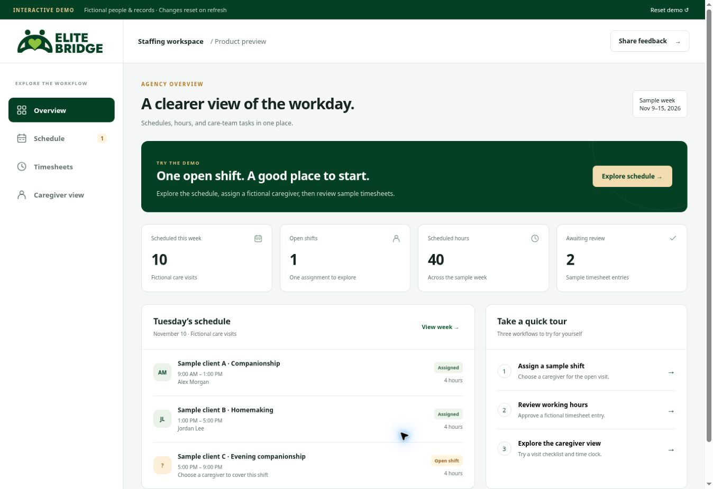
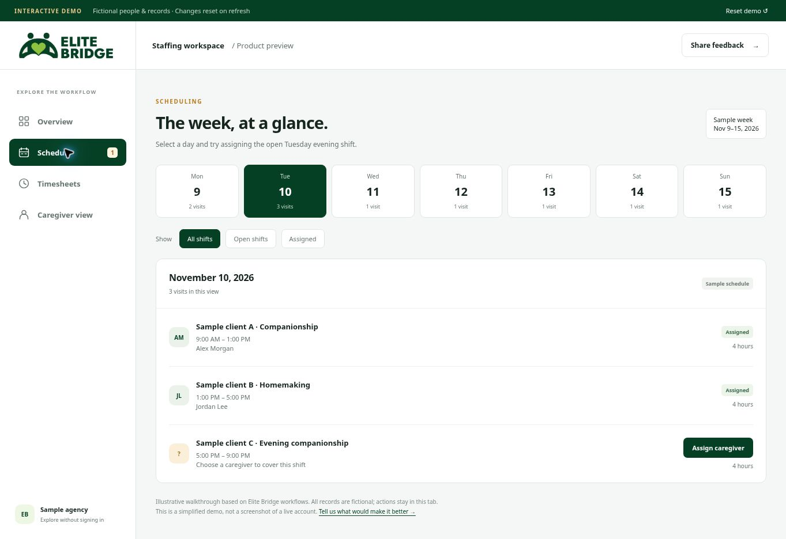
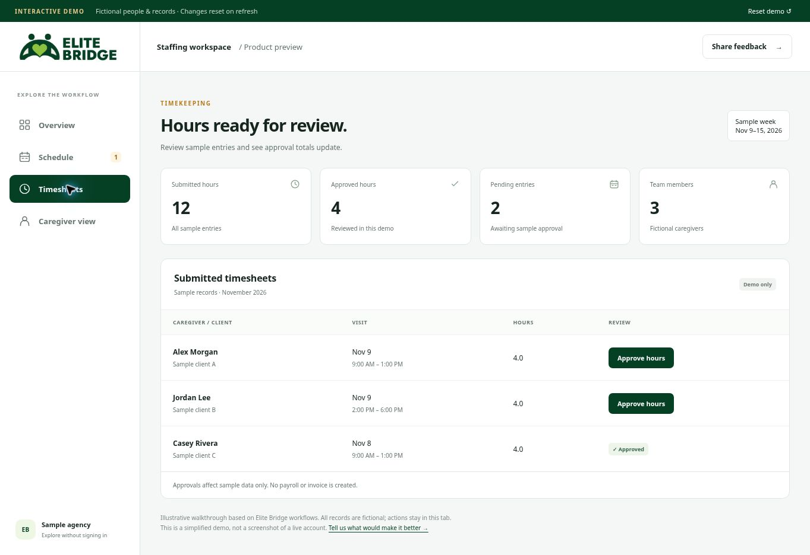
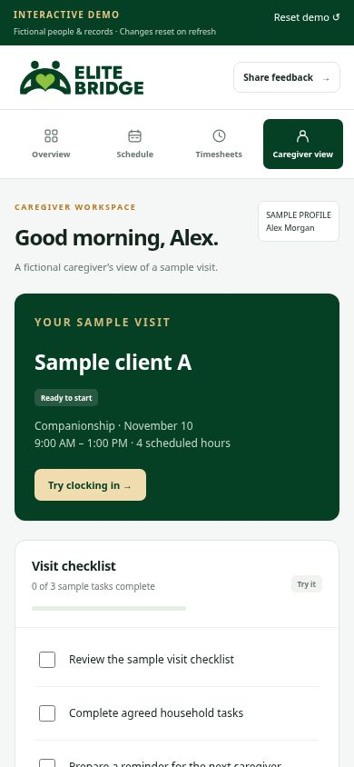

# Elite Bridge — Staffing Software Showcase

**Explore staffing workflows. Help us make them better.**

[**Try the interactive demo →**](https://elite-bridge-interactive-demo.evansonsaitoti.chatgpt.site) · [**Leave feedback →**](https://github.com/evansonsaitoti/elite-bridge-showcase/discussions/1)

Elite Bridge is a staffing software project developed around the operational needs of Elite Bridge Staffing LLC. We welcome practical feedback from agency owners, caregivers, designers, and developers.

> **Preview, not a live account.** The demo is a separate, simplified implementation based on Elite Bridge workflows and branding. All people and records are fictional. Changes stay in your browser tab and reset on refresh. The production application's source code and operational data remain private.

## Explore the demo

No sign-in required. Try these three steps:

1. **Schedule:** select Tuesday, November 10, then assign a fictional caregiver to the open evening shift.
2. **Timesheets:** approve a sample entry and watch the approval totals change.
3. **Caregiver view:** try the sample time clock, simulate a four-hour visit, and check off sample tasks. The simulated visit adds an entry to the demo timesheets.

Use **Reset demo** to start again. No messages, assignments, payroll actions, or invoices are sent to real systems. The demo is not connected to Elite Bridge's backend.

## Screenshots of the fictional-data demo

These screenshots show the public demo, not production accounts or an exact reproduction of every current app screen.

### Agency overview

### Scheduling

### Timesheet review

### Mobile caregiver view

## What the project is working toward

Coordinating shifts, caregiver availability, timesheets, and billing can create repeated administrative work. Our goal is to make those workflows easier to manage and easier for staff to understand.

| Area | Project scope | In this public demo |
| --- | --- | --- |
| Scheduling | Organize shifts and caregiver assignments | Sample week, filters, and shift assignment |
| Caregiver workflows | Support day-to-day work | Simulated time clock and checklist |
| Timesheets | Track and review working hours | Sample approvals and updated totals |
| Caregiver onboarding | Invite caregivers into the workflow | Not included |
| Invoicing and expenses | Support agency administration | Not included |

This describes the project's scope, not a guarantee that every capability is available in every app or release. The demo has no account creation, live messaging, real payments, or production integrations.

## Help shape the next version

After trying the demo, tell us:

- **Agency owners:** Which task takes the most time each week, and how do you handle it today?
- **Caregivers:** Is the schedule and visit workflow clear on your phone? What is missing?
- **Designers:** Where is the interface confusing or unnecessarily complicated?
- **Developers:** What patterns or projects should we learn from for dependable scheduling and permissions?
- **Potential users:** What would you need before trying the real product?

Please describe the screen or workflow, the problem, and the outcome you would prefer. Links to comparable products and open-source projects are welcome when you explain what we should learn from them.

[Join the feedback discussion](https://github.com/evansonsaitoti/elite-bridge-showcase/discussions/1) or [submit a structured suggestion](https://github.com/evansonsaitoti/elite-bridge-showcase/issues/new/choose). Star this repository to save it.

## Ideas under consideration

These are exploratory ideas, not released features or delivery commitments:

- AI assistance with administrative follow-ups.
- Suggestions for filling uncovered shifts, with manager review.
- Checks for inconsistencies between approved hours and invoices.
- Branded workspaces for other agencies, subject to validation and development.

## Privacy and feedback guidelines

Use fictional examples. Do not post client or employee records, health information, private contact details, passwords, or screenshots containing real operational data. Do not disclose security vulnerabilities publicly.

## About Elite Bridge

[Elite Bridge Staffing website](https://elitebridgestaffing.com)

This repository is for product feedback. It is not a channel for requesting care, submitting job applications, or contacting the agency about urgent staffing matters.
